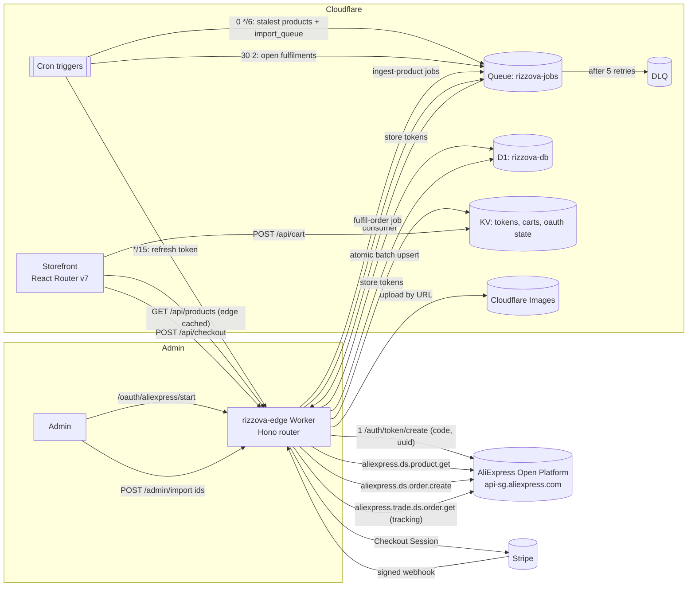

# Rizzova Edge: architecture

A serverless dropshipping store that runs entirely on Cloudflare, with AliExpress (AE-Dropshipper API) as the supplier and Stripe for payment. The current WooCommerce shop on Hostinger stays live and untouched while this is built.

## Framework choice

**React Router v7** (the successor to Remix) is the recommended storefront framework. Cloudflare maintains its own Vite plugin for it, it runs on the Workers runtime without an adapter layer, and loaders can read the same D1 and KV bindings directly.

Next.js works through the OpenNext adapter, which is an extra layer to keep up to date. Nuxt works through Nitro's Cloudflare preset.

Cloudflare now points new full-stack apps at **Workers with static assets** rather than Pages. Pages still works. Either way the storefront binds the same D1 and KV namespaces as this API Worker.

## System map

### 1. Token acquisition

1. An admin opens `/oauth/aliexpress/start` (admin token required). The Worker stores a one-time `state` in KV for 10 minutes and redirects to AliExpress consent.
2. AliExpress redirects to `/oauth/aliexpress/callback?code=…&state=…[&uuid=…]`. The Worker checks `state`, then calls `/auth/token/create` with `code` (required) and `uuid` (optional). The call is signed with HMAC-SHA256 using Web Crypto, with no SDK.
3. `access_token`, `refresh_token` and both expiry times go to D1 (`auth_tokens`). A hot copy of the access token goes to KV with a TTL that ends 60 seconds before the real expiry.
4. A cron runs every 15 minutes and refreshes the token when less than 24 hours remain. It logs a warning when the refresh token has less than 7 days left, which means an admin must authorise again. `GET /oauth/aliexpress/health` returns these metrics.

### 2. Product ingestion

1. `POST /admin/import {"productIds": [...]}` writes ids to `import_queue` and sends one `ingest-product` job each to the Queue.
2. The Queue consumer calls `aliexpress.ds.product.get` with the store's ship-to country, currency and language.
3. Each SKU becomes a variant. **Cost** is the AliExpress `offer_sale_price`, and **retail** is cost × `PRICE_MARKUP`, rounded up to .99. `sku_attr` is kept, because AliExpress needs it to place the order.
4. Gallery images (up to 8) and variant swatches are uploaded to Cloudflare Images by URL. Each image gets a deterministic id (`ae-<product>-<hash>`), so a re-sync never duplicates media. One failed image does not block the product.
5. Everything is committed in **one D1 batch**, which runs as one transaction:
   - product upsert,
   - variant upserts (child rows find their parent through a sub-select, so there is no extra round trip),
   - deactivation of vanished SKUs, using a run stamp rather than a large `NOT IN` list, because D1 limits a query to 100 bound parameters,
   - image rows,
   - denormalised `min_price`, `max_price` and `total_stock` for fast listing pages.
6. Every 6 hours, a cron re-queues the 200 least recently synced products and drains `import_queue`. Failures are written to `products.sync_error` and retried with exponential backoff. After 5 attempts a job goes to the dead-letter queue.

### 3. Checkout and tracking

1. The cart lives in KV (`cart:<uuid>`, 14-day TTL), keyed by an httpOnly cookie. Quantities are checked against stock.
2. `POST /api/checkout` re-prices every line from D1, so client prices are never trusted. It writes a `pending` order and its items atomically, then creates a Stripe Checkout Session through the REST API with an idempotency key.
3. The Stripe webhook verifies the `Stripe-Signature` HMAC with a 5-minute tolerance and a constant-time comparison.
   - It skips event ids it has already processed, and records an event only after it succeeds, so Stripe's retries still work.
   - It marks the order `paid` with the shipping details, but only while the order is still `pending`.
   - It then sends a `fulfil-order` job.
4. The fulfilment job places the AliExpress order with `aliexpress.ds.order.create`. It never places a second order if one already exists, and stores each AliExpress order id in `fulfillments`.
5. A daily cron polls `aliexpress.trade.ds.order.get` for tracking, and moves orders to `shipped` and then `delivered`.

## Edge caching

- **`GET /api/products`:**
  - uses keyset pagination on `(created_at, id)`, which costs the same at page 1 and page 10,000 because there are no `OFFSET` scans;
  - sends `s-maxage=60, stale-while-revalidate=300`;
  - stores the response in the Workers Cache API.
- **The Cache API only applies on a custom domain** such as `api.rizzova.com`, not on `*.workers.dev`.
- **Search** uses SQLite FTS5 (`products_fts`), which triggers keep in sync with the product titles.
- **Images** are served from `imagedelivery.net` and resized by Cloudflare Images variants.
